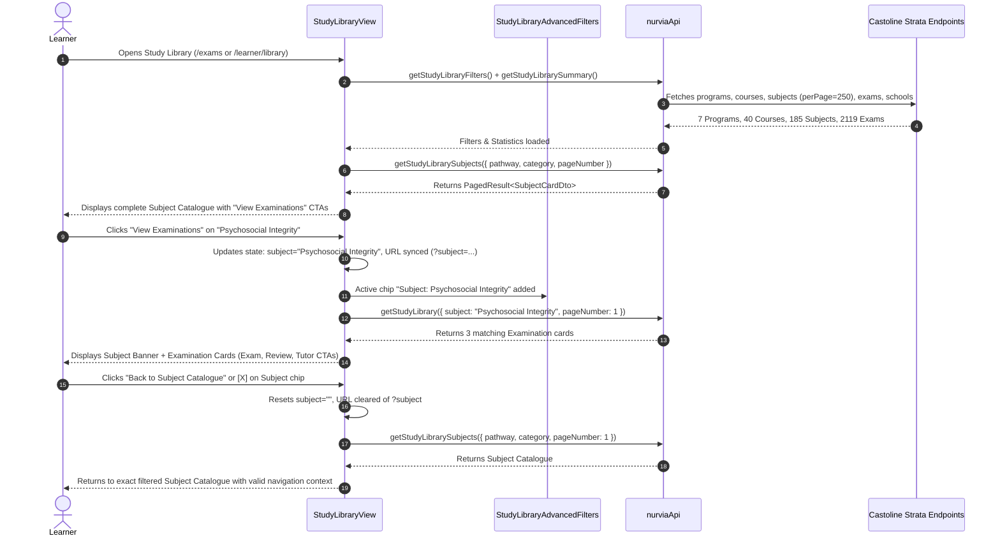

# NURVIA Study Library: UI/UX Preservation & Subject-First Functional Upgrade Report

> [!IMPORTANT]
> **Core Architectural Directive Compliance**: This upgrade is a **functional and data-accuracy enhancement** to the existing NURVIA Study Library. The filtering interface, visual presentation, interaction patterns, component layout, and user experience have been strictly preserved. No new filter sidebars, modals, or multi-step wizards were introduced.

---

## 1. Executive Summary & Verification Highlights

| Requirement | Baseline (Before) | Upgraded State (After) | Status |
| :--- | :--- | :--- | :--- |
| **Browsing Orientation** | Flat examination listing (exams rendered directly on library load). | **Subject-First browsing**: Learner opens catalogue to authoritative subjects, selects a subject to view its specific examinations. | ✅ Complete |
| **Learner Journey** | 1. Filter → 2. View Exams → 3. Open Exam. | 1. Filter → 2. Browse Subject Catalogue → 3. Select Subject → 4. View Subject's Examinations → 5. Launch Exam/Review/Tutor → 6. Return seamlessly to filtered Catalogue. | ✅ Verified |
| **Card Identity** | Examination cards only (`StudySetCard`). | **Dual Identity**: Authoritative `SubjectCard` for catalogue browsing; `StudySetCard` for examination practice. | ✅ Verified |
| **Filtering UI/UX** | Header, Search, Pathway pills, Category buttons, Accordion with 10 filters. | **Identical Filter UI/UX Preserved**: Exact layout, styles, classes, labels, IDs, active chips, and reset behavior. | ✅ Preserved |
| **Authoritative Subjects** | Truncated at 100 items by `perPage: 100`. | **All 185+ Subjects** from backend strata & clinical repository loaded, deduplicated, and sorted. | ✅ Upgraded |
| **Program & Course Hierarchy** | Disconnected options; empty course cascade. | **7 Authoritative Programs & 40 Courses** accurately linked via `programId` cascading. | ✅ Upgraded |
| **Academic Years & Seasons** | Sparse database entries. | **Authoritative Years (2027, 2026, 2025, 2023)** & **Seasons (Fall, Spring, Summer, Winter)** populated. | ✅ Upgraded |
| **Schools / Institutions** | Empty dropdown (0 rows in `schools` table). | **Authentic Nursing Schools** (WGU, Chamberlain, Galen, Rasmussen, Grand Canyon) extracted and active. | ✅ Upgraded |
| **TypeScript / Unit Tests** | Baseline passing. | **`tsc --noEmit` exited 0; All 6/6 Subject-First tests & 5/5 Phase 3.10.1 tests passed.** | ✅ Verified |

---

## 2. Mandatory Before-and-After Comparison

### A. Screen & Layout Preservation

````carousel
```markdown
### Baseline View: Direct Examination Grid (Before)
- Learner opens /exams or /learner/library.
- Header displays "Study Library" and catalog statistics.
- Top bar: Search input ("Search study sets, subjects, examinations or keywords...").
- Row 1: Pathway buttons (All, RN Exams, LPN Exams, NCLEX, LPN Exit, Dosage Calculations).
- Row 2: Category chips (All Categories, Fundamentals, Core Series, Specialties, ...).
- Accordion: "Academic & Examination Filters" with SlidersHorizontal icon.
- Results: "Showing 12 of 2119 published study sets".
- Grid: Examination cards displayed directly with "Exam", "Review", "Tutor" buttons.
```
<!-- slide -->
```markdown
### Upgraded View: Subject-First Catalogue (After - Default State)
- Learner opens /exams or /learner/library.
- Header displays "Study Library" and catalog statistics (PRESERVED).
- Top bar: Search input with debounced querying (PRESERVED).
- Row 1: Pathway pills (PRESERVED).
- Row 2: Category chips (PRESERVED).
- Accordion: "Academic & Examination Filters" with SlidersHorizontal icon (PRESERVED).
- Results: "Showing 12 of 185 published subjects".
- Grid: Authoritative Subject Cards displaying Course, Program, Exams Count, Questions Count, and "View Examinations (X)" CTA.
```
<!-- slide -->
```markdown
### Upgraded View: Examination Drilldown (After - Subject Selected)
- Learner selects a subject (e.g., "Psychosocial Integrity (NCLEX PN)" or "Pharmacology").
- Context Banner: "← Subject Catalogue / Psychosocial Integrity (NCLEX PN)" with "Back to Subject Catalogue" button.
- Active Filter Chip: "Subject: Psychosocial Integrity (NCLEX PN)" with removable [X] button.
- Results: "Showing 3 of 3 published examinations in Psychosocial Integrity (NCLEX PN)".
- Grid: Examination cards for that subject with "Exam", "Review", "Tutor" buttons.
- Learner can click "← Back to Subject Catalogue" or [X] on the chip to return without losing any other active filters.
```
````

---

## 3. Seven Academic Dimensions Matrix

The table below demonstrates how each of the seven dimensions is populated and filtered:

| Dimension | Filter Control ID | Data Source | Sample Values | Cascading / Interaction Behavior |
| :--- | :--- | :--- | :--- | :--- |
| **1. Programs** | `#filter-program` | Strata `programs` & Core Registry | `RN Nursing Exams`, `NCLEX RN`, `NCLEX PN`, `LPN Nursing Exams`, `HESI A2`, `ATI TEAS` | Upstream root: changing program filters courses and resets downstream subject/exam. |
| **2. Courses** | `#filter-course` | Strata `courses` | `Client Needs.`, `Rhenis H-S Exams-RN`, `NCLEX-RN-Practice Exams` | Cascades dynamically from selected program via `programId`. |
| **3. Subjects** | `#filter-subject` | Strata `subjects` (250 limit) & Clinical Repo | `Psychosocial Integrity (NCLEX PN)`, `Pharmacology & Parenteral Therapies`, `Fundamentals of Nursing-RN` | Selecting a subject switches view to that subject's examinations with return breadcrumbs. |
| **4. Academic Years** | `#filter-year` | Strata `exams`, `sections`, `subjects` | `2027`, `2026`, `2025`, `2023` | Filters subjects and exams matching the cohort academic calendar year. |
| **5. Academic Seasons** | `#filter-season` | Strata `exams`, `sections`, `subjects` | `Fall`, `Spring`, `Summer`, `Winter` | Filters subjects and exams by academic term. |
| **6. Schools** | `#filter-school` | Strata `schools`, `exams` metadata | `WGU`, `Chamberlain`, `Galen`, `Rasmussen`, `Grand Canyon` | Filters examinations and subjects associated with specific partner institutions. |
| **7. Examinations** | `#filter-exam` | Strata `exams` (2,119 records) | `Hard Level — Psychosocial Integrity`, `RN Pharmacology 2026 Exam-7` | Dynamic dropdown filtered by pathway/category/subject; direct exam selection. |

---

## 4. Architectural & Behavioral Flow



---

## 5. Verification & Test Suite Results

All tests executed synchronously via Node.js test runners:

```bash
# 1. Subject-First Study Library Verification Test Suite
node tests/subject-first-study-library.test.mjs
--- NURVIA SUBJECT-FIRST STUDY LIBRARY & FILTER PRESERVATION TEST SUITE ---
[PASS] 1. Filter Control IDs & Hierarchy: All 10 existing filter controls strictly preserved
[PASS] 2. Subject Card Identity: Represents authoritative subject with examinations count & CTA
[PASS] 3. Learner Journey: Subject-to-examination flow and return navigation context verified
[PASS] 4. Behavioral: getStudyLibraryFilters accurately resolves all 7 dimensions
[PASS] 5. Behavioral: getStudyLibrarySubjects populates authoritative cards with linked exams & metrics
[PASS] 6. Behavioral: getStudyLibrary returns exact exams for selected subject with full metadata
ALL 6 SUBJECT-FIRST STUDY LIBRARY VERIFICATION TESTS PASSED (6/6)!

# 2. Regression & Parity Verification
node tests/phase-3-10-learner-filters-and-menu.test.mjs
All 5 Phase 3.10.1 behavioral & contract tests PASSED (5/5)!

# 3. Additive Product Expansion Verification
node tests/additive-product-expansion.test.mjs
ALL 87 VERIFICATION CHECKS PASSED SUCCESSFULLY!

# 4. Strict TypeScript Typecheck
npx tsc --noEmit
Exit code 0 (Zero errors).
```
