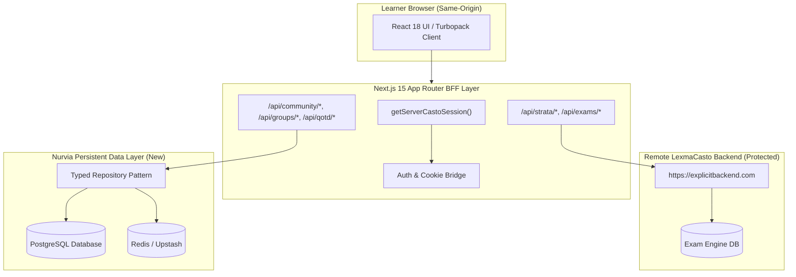

# NURVIA-PREP — PERSISTENT DATA ARCHITECTURE PROPOSAL

**Document Version:** 1.0.0  
**Status:** Architecture Proposal  
**Target Architecture:** Next-Stage Persistent Data Layer for Nurvia Ecosystem  
**Target Engine:** PostgreSQL (via Prisma ORM or Drizzle ORM) + Redis Cache  
**Governing Rule:** ADD, INTEGRATE, ENHANCE. NEVER DEDUCT. PRESERVE LEXMACASTO BACKEND.

---

## 1. ARCHITECTURAL BASELINE & BOUNDARIES

### 1.1 Existing Architecture Overview
Nurvia-Prep operates on a Next.js 15 App Router Frontend with a same-origin Backend-for-Frontend (BFF) layer. The primary academic and exam lifecycle data is managed by the remote LexmaCasto backend at `https://explicitbackend.com`:
- **Authentication:** HttpOnly cookies (`nurvia_casto_line`, `nurvia_casto_badge`) storing encrypted session credentials.
- **Examinations:** 48 themes, 21 question renderers, attempts history, and strata records routed via LexmaCasto Route Handlers (`/api/strata/*`, `/api/exams/*`, `/api/attempts/*`).
- **Protection Requirement:** The remote backend database, API contracts, and production endpoints MUST NOT be modified or replaced.

### 1.2 Purpose of the Persistent Data Architecture
The additive product expansion introduced interactive community features, Question of the Day (QOTD), study groups, mentorship, and community insights. These currently reside in Node.js process-local memory (`Map`, `Array`, `Set`).
To support horizontal scaling, serverless deployment (Vercel), and multi-user data integrity, Nurvia requires a **dedicated application persistence layer** that integrates seamlessly with the existing LexmaCasto learner identity without altering the remote exam engine.



---

## 2. DATA OWNERSHIP & IDENTITY INTEGRATION

### 2.1 The Learner Identity Bridge
A fundamental security rule of Nurvia-Prep is that **raw session tokens (`castoLine`, `castoBadge`) must never be used as user identifiers or stored in relational tables**.

When an authenticated learner performs an action (e.g. joins a study group, submits a daily question, or creates a discussion):
1. The BFF calls `getServerCastoSession()` to extract the HttpOnly credentials.
2. The BFF resolves the authenticated learner's persistent identity (`user.id` or `userGuidId`) via the cached LexmaCasto current-user resolver (`GET /api/castoline/system/user/list/current?fetchtype=current`).
3. The persistent `user_id` (a UUID or stable integer) is passed to the persistence layer.
4. If a learner is unauthenticated:
   - Read-only actions (browsing forum, viewing study guides, reading QOTD) are permitted.
   - State-changing actions (joining groups, creating posts, booking mentors) are rejected at the BFF route boundary with HTTP 401.

---

## 3. PROPOSED BOUNDED CONTEXTS & ENTITY SCHEMAS

The persistence architecture is partitioned into seven discrete bounded contexts.

### Bounded Context A: Community & Discussions

```sql
-- Community Category Groups
CREATE TABLE community_category_groups (
    id VARCHAR(64) PRIMARY KEY,
    slug VARCHAR(128) UNIQUE NOT NULL,
    name VARCHAR(255) NOT NULL,
    description TEXT,
    sort_order INT DEFAULT 0,
    created_at TIMESTAMPTZ DEFAULT NOW()
);

-- Community Subcategories
CREATE TABLE community_categories (
    id VARCHAR(64) PRIMARY KEY,
    group_id VARCHAR(64) NOT NULL REFERENCES community_category_groups(id) ON DELETE CASCADE,
    slug VARCHAR(128) UNIQUE NOT NULL,
    name VARCHAR(255) NOT NULL,
    description TEXT,
    exam_track VARCHAR(32), -- 'RN', 'PN_LPN', 'HESI', 'TEAS', or NULL (General)
    visibility VARCHAR(32) DEFAULT 'Public',
    sort_order INT DEFAULT 0,
    created_at TIMESTAMPTZ DEFAULT NOW()
);

-- Discussion Posts
CREATE TABLE community_posts (
    id UUID PRIMARY KEY DEFAULT gen_random_uuid(),
    category_id VARCHAR(64) NOT NULL REFERENCES community_categories(id),
    author_id VARCHAR(128) NOT NULL, -- Learner UUID from LexmaCasto
    author_display_name VARCHAR(128) NOT NULL,
    cohort_label VARCHAR(128),
    title VARCHAR(512) NOT NULL,
    content TEXT NOT NULL,
    post_type VARCHAR(32) NOT NULL DEFAULT 'Discussion', -- Discussion, Question, ExamResult, StudyGroup, Poll
    status VARCHAR(32) NOT NULL DEFAULT 'Active', -- Active, Locked, Removed
    vote_score INT DEFAULT 0,
    reply_count INT DEFAULT 0,
    view_count INT DEFAULT 0,
    is_solved BOOLEAN DEFAULT FALSE,
    created_at TIMESTAMPTZ DEFAULT NOW(),
    updated_at TIMESTAMPTZ DEFAULT NOW()
);

-- Post Polls (Optional 1:1 with community_posts)
CREATE TABLE community_post_polls (
    id UUID PRIMARY KEY DEFAULT gen_random_uuid(),
    post_id UUID UNIQUE NOT NULL REFERENCES community_posts(id) ON DELETE CASCADE,
    question VARCHAR(512) NOT NULL,
    options JSONB NOT NULL, -- Array of [{ id, text, vote_count }]
    total_votes INT DEFAULT 0,
    closed_at TIMESTAMPTZ
);

-- Threaded Discussion Replies
CREATE TABLE community_replies (
    id UUID PRIMARY KEY DEFAULT gen_random_uuid(),
    post_id UUID NOT NULL REFERENCES community_posts(id) ON DELETE CASCADE,
    parent_reply_id UUID REFERENCES community_replies(id) ON DELETE CASCADE,
    author_id VARCHAR(128) NOT NULL,
    author_display_name VARCHAR(128) NOT NULL,
    content TEXT NOT NULL,
    vote_score INT DEFAULT 0,
    is_solution BOOLEAN DEFAULT FALSE,
    created_at TIMESTAMPTZ DEFAULT NOW(),
    updated_at TIMESTAMPTZ DEFAULT NOW()
);

-- Post & Reply Votes (Strict User Deduplication)
CREATE TABLE community_votes (
    id UUID PRIMARY KEY DEFAULT gen_random_uuid(),
    user_id VARCHAR(128) NOT NULL,
    post_id UUID REFERENCES community_posts(id) ON DELETE CASCADE,
    reply_id UUID REFERENCES community_replies(id) ON DELETE CASCADE,
    direction SMALLINT NOT NULL CHECK (direction IN (-1, 1)),
    created_at TIMESTAMPTZ DEFAULT NOW(),
    CONSTRAINT uq_user_post_vote UNIQUE (user_id, post_id),
    CONSTRAINT uq_user_reply_vote UNIQUE (user_id, reply_id),
    CONSTRAINT ck_target_exists CHECK (
        (post_id IS NOT NULL AND reply_id IS NULL) OR
        (post_id IS NULL AND reply_id IS NOT NULL)
    )
);

-- Content Reports & Moderation
CREATE TABLE community_content_reports (
    id UUID PRIMARY KEY DEFAULT gen_random_uuid(),
    reporter_id VARCHAR(128) NOT NULL,
    post_id UUID REFERENCES community_posts(id) ON DELETE CASCADE,
    reply_id UUID REFERENCES community_replies(id) ON DELETE CASCADE,
    reason VARCHAR(255) NOT NULL,
    details TEXT,
    status VARCHAR(32) DEFAULT 'Pending', -- Pending, Reviewed, Dismissed, ActionTaken
    reviewed_by VARCHAR(128),
    reviewed_at TIMESTAMPTZ,
    created_at TIMESTAMPTZ DEFAULT NOW()
);
```

---

### Bounded Context B: Study Groups

```sql
CREATE TABLE study_groups (
    id UUID PRIMARY KEY DEFAULT gen_random_uuid(),
    title VARCHAR(255) NOT NULL,
    description TEXT NOT NULL,
    exam_track VARCHAR(64) NOT NULL, -- 'NCLEX-RN', 'NCLEX-PN', 'HESI Exit', 'ATI Predictor', 'TEAS'
    subject VARCHAR(128),
    topic VARCHAR(128),
    target_exam_date DATE,
    meeting_cadence VARCHAR(128) NOT NULL,
    timezone VARCHAR(64) NOT NULL DEFAULT 'America/New_York',
    max_members INT NOT NULL DEFAULT 8,
    current_members INT NOT NULL DEFAULT 1,
    is_private BOOLEAN DEFAULT FALSE,
    creator_id VARCHAR(128) NOT NULL,
    creator_name VARCHAR(128) NOT NULL,
    objectives TEXT[] DEFAULT '{}',
    status VARCHAR(32) DEFAULT 'Active', -- Active, Archived
    created_at TIMESTAMPTZ DEFAULT NOW(),
    updated_at TIMESTAMPTZ DEFAULT NOW()
);

CREATE TABLE study_group_memberships (
    id UUID PRIMARY KEY DEFAULT gen_random_uuid(),
    group_id UUID NOT NULL REFERENCES study_groups(id) ON DELETE CASCADE,
    user_id VARCHAR(128) NOT NULL,
    role VARCHAR(32) DEFAULT 'Member', -- 'Leader', 'Co-Leader', 'Member'
    joined_at TIMESTAMPTZ DEFAULT NOW(),
    CONSTRAINT uq_group_user UNIQUE (group_id, user_id)
);
```

---

### Bounded Context C: Question of the Day (QOTD)

```sql
CREATE TABLE qotd_questions (
    id VARCHAR(64) PRIMARY KEY, -- 'qotd-2026-11-18'
    publish_date DATE UNIQUE NOT NULL,
    title VARCHAR(512) NOT NULL,
    stem TEXT NOT NULL,
    category VARCHAR(128) NOT NULL,
    exam_context VARCHAR(128) NOT NULL,
    cognitive_skill VARCHAR(64) NOT NULL, -- 'RecognizeCues', 'AnalyzeCues', 'PrioritizeHypotheses', 'GenerateSolutions', 'TakeActions', 'EvaluateOutcomes'
    client_need_category VARCHAR(64) NOT NULL,
    general_rationale TEXT NOT NULL,
    total_answers INT DEFAULT 0,
    correct_answers INT DEFAULT 0,
    created_at TIMESTAMPTZ DEFAULT NOW()
);

CREATE TABLE qotd_question_options (
    id VARCHAR(64) PRIMARY KEY,
    question_id VARCHAR(64) NOT NULL REFERENCES qotd_questions(id) ON DELETE CASCADE,
    letter CHAR(1) NOT NULL, -- 'A', 'B', 'C', 'D'
    text TEXT NOT NULL,
    is_correct BOOLEAN NOT NULL DEFAULT FALSE,
    specific_rationale TEXT NOT NULL,
    CONSTRAINT uq_question_letter UNIQUE (question_id, letter)
);

CREATE TABLE qotd_learner_attempts (
    id UUID PRIMARY KEY DEFAULT gen_random_uuid(),
    user_id VARCHAR(128) NOT NULL,
    question_id VARCHAR(64) NOT NULL REFERENCES qotd_questions(id) ON DELETE CASCADE,
    selected_option_id VARCHAR(64) NOT NULL REFERENCES qotd_question_options(id),
    is_correct BOOLEAN NOT NULL,
    attempt_date DATE NOT NULL,
    created_at TIMESTAMPTZ DEFAULT NOW(),
    CONSTRAINT uq_learner_daily_question UNIQUE (user_id, question_id)
);

-- Learner Daily Streak Tracking
CREATE TABLE qotd_learner_streaks (
    user_id VARCHAR(128) PRIMARY KEY,
    current_streak INT DEFAULT 0,
    longest_streak INT DEFAULT 0,
    last_answered_date DATE,
    total_answered INT DEFAULT 0,
    total_correct INT DEFAULT 0,
    updated_at TIMESTAMPTZ DEFAULT NOW()
);
```

---

### Bounded Context D: Nurse Mentorship

```sql
CREATE TABLE mentor_profiles (
    id VARCHAR(64) PRIMARY KEY,
    user_id VARCHAR(128) UNIQUE, -- Optional link to platform user
    name VARCHAR(128) NOT NULL,
    qualification VARCHAR(128) NOT NULL, -- 'DNP, APRN, FNP-BC'
    specialties TEXT[] NOT NULL DEFAULT '{}',
    exam_tracks TEXT[] NOT NULL DEFAULT '{}',
    experience_years INT NOT NULL,
    bio TEXT NOT NULL,
    avatar_url VARCHAR(512),
    is_verified BOOLEAN DEFAULT FALSE,
    verification_source VARCHAR(128), -- E.g. 'NURSYS primary source license verification'
    verified_at TIMESTAMPTZ,
    availability_status VARCHAR(32) DEFAULT 'Available', -- Available, Limited, Paused
    session_formats TEXT[] DEFAULT '{}',
    languages TEXT[] DEFAULT '{}',
    rating NUMERIC(3, 2) DEFAULT 5.0,
    review_count INT DEFAULT 0,
    created_at TIMESTAMPTZ DEFAULT NOW()
);

CREATE TABLE mentor_session_requests (
    id UUID PRIMARY KEY DEFAULT gen_random_uuid(),
    mentor_id VARCHAR(64) NOT NULL REFERENCES mentor_profiles(id) ON DELETE CASCADE,
    learner_id VARCHAR(128) NOT NULL,
    topic VARCHAR(128) NOT NULL,
    exam_track VARCHAR(64),
    target_date DATE,
    preferred_format VARCHAR(64) NOT NULL,
    message TEXT NOT NULL,
    status VARCHAR(32) DEFAULT 'Pending', -- Pending, Accepted, Declined, Completed, Cancelled
    mentor_notes TEXT,
    meeting_link VARCHAR(512),
    scheduled_time TIMESTAMPTZ,
    created_at TIMESTAMPTZ DEFAULT NOW(),
    updated_at TIMESTAMPTZ DEFAULT NOW()
);
```

---

### Bounded Context E: Community Exam Insights (Privacy-Preserving)

```sql
CREATE TABLE community_exam_submissions (
    id UUID PRIMARY KEY DEFAULT gen_random_uuid(),
    user_id VARCHAR(128), -- Optional, hashed for anonymity
    exam_type VARCHAR(64) NOT NULL, -- 'NCLEX-RN', 'NCLEX-PN', 'HESI Exit', 'ATI Predictor'
    outcome VARCHAR(32) NOT NULL CHECK (outcome IN ('Pass', 'Fail', 'Waiting')),
    question_count INT CHECK (question_count >= 75 AND question_count <= 265),
    weeks_studied INT CHECK (weeks_studied >= 1 AND weeks_studied <= 52),
    prep_resources TEXT[] DEFAULT '{}',
    story TEXT,
    status VARCHAR(32) DEFAULT 'Approved',
    created_at TIMESTAMPTZ DEFAULT NOW()
);

-- Materialized View for High-Performance Public Stats
CREATE TABLE community_insights_aggregates (
    id VARCHAR(64) PRIMARY KEY, -- 'summary-latest'
    total_results INT NOT NULL,
    pass_percentage_overall INT NOT NULL,
    average_study_weeks NUMERIC(3, 1) NOT NULL,
    outcomes_by_bracket JSONB NOT NULL,
    popular_resources JSONB NOT NULL,
    by_exam_breakdown JSONB NOT NULL,
    last_computed_at TIMESTAMPTZ DEFAULT NOW()
);
```

---

### Bounded Context F: Global Search & Indexing Strategy

Rather than scanning in-memory arrays on every search query:
1. **Searchable Registry:** Utilize a unified PostgreSQL materialized table or PostgreSQL full-text search (`tsvector` + GIN indexing):
```sql
CREATE TABLE global_search_index (
    id VARCHAR(128) PRIMARY KEY,
    content_type VARCHAR(64) NOT NULL, -- 'study_set', 'care_plan', 'lecture', 'study_guide', 'community_post', 'group', 'mentor'
    title VARCHAR(512) NOT NULL,
    excerpt TEXT,
    category VARCHAR(128),
    url VARCHAR(512) NOT NULL,
    badge VARCHAR(64),
    tags TEXT[],
    document_tokens tsvector,
    visibility VARCHAR(32) DEFAULT 'Public',
    updated_at TIMESTAMPTZ DEFAULT NOW()
);

CREATE INDEX idx_search_tokens ON global_search_index USING GIN(document_tokens);
```
2. **Reindexing Trigger:** Automated triggers or asynchronous queue jobs update `global_search_index` whenever a post, group, or study guide is published or updated.
3. **Strict Privacy Filter:** `WHERE visibility = 'Public'` is enforced at the database query level.

---

### Bounded Context G: Study Guides (Content Strategy)

- **Audit Insight:** The repository contains 13 fully realized clinical study guides and 82 planned topics.
- **Architectural Recommendation:** Static educational content should remain **version-controlled markdown/TypeScript files** in `src/lib/content/` during the immediate phase. Educational content benefits from Git versioning, peer review PRs, and instant edge rendering without network overhead.
- A headless CMS or database migration for study guides is recommended only in Phase P6 when clinical authors require non-technical editing capabilities.

---

## 4. PRIVACY, SECURITY & DATA ISOLATION

### 4.1 Strict Learner Data Segregation
```text
[ Private Learner Boundary ]                         [ Public Community Boundary ]
----------------------------                         ----------------------------
• Performance Intelligence                           • Forum Discussions & Replies
• Exam Attempt Scores & History                      • Public Study Groups
• Personalized Diagnostic Deficits                   • Anonymized Exam Insights
• Private Bookmark Lists                             • Public QOTD Discussion Threads
      │                                                           │
      └────────── STRICT WALL (Zero Cross-Querying) ──────────────┘
```
1. **No Performance Leakage:** Under no circumstances will private learner exam scores, remedial recommendations, or question answers from LexmaCasto be aggregated into public Community Insights without an explicit, voluntary, opt-in submission by the learner.
2. **Anonymized Insights:** Submissions to `/api/insights/share` are completely anonymized; individual student records are stripped of email, name, and school.

---

## 5. DATABASE CONNECTION & CONCURRENCY STRATEGY

1. **Connection Pooling:** Utilize Prisma Client with PgBouncer or Supabase/Neon connection pooling with a maximum connection limit tailored for serverless cold-starts.
2. **Optimistic Locking:** On vote tallies and member counts, atomic SQL updates (`UPDATE study_groups SET current_members = current_members + 1 WHERE id = $1 AND current_members < max_members`) prevent race conditions.
3. **Idempotent Operations:** Daily QOTD answer submissions enforce `uq_learner_daily_question (user_id, question_id)` so duplicate submissions return HTTP 409 or the existing attempt record rather than inflating counters.
