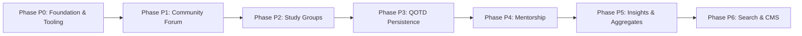

# NURVIA-PREP — PERSISTENCE IMPLEMENTATION ROADMAP

**Document Version:** 1.0.0  
**Status:** Engineering Roadmap  
**Target Delivery:** Phased Production Persistence for Nurvia Ecosystem  
**Governing Rule:** ADD, INTEGRATE, ENHANCE. NEVER DEDUCT. PRESERVE LEXMACASTO BACKEND.

---

## 1. ROADMAP OVERVIEW

This roadmap outlines the engineering steps to transition the additive product expansion features from process-local in-memory stores to a durable, multi-instance persistence architecture. Each phase is independently deliverable, testable, and roll-backable, ensuring zero disruption to existing examination workflows.

---

## 2. PHASED EXECUTION SPECIFICATIONS

### PHASE P0 — Persistence Foundation & ORM Setup
- **Scope:** Establish database connection, ORM schema tooling, migration runner, and typed repository interfaces.
- **Dependencies:** None.
- **Database Entities:** Core connection setup, Prisma/Drizzle configuration, initial migration table.
- **API Changes:** None (internal database bridge only).
- **UI Impact:** Zero UI change.
- **Security Requirements:** Database credentials stored exclusively in server environment variables (`DATABASE_URL`, `DATABASE_DIRECT_URL`). SSL required in production (`sslmode=require`).
- **Migration Requirements:** Establish automated CI migration verification.
- **Test Requirements:** Automated database connection and health check tests.
- **Acceptance Criteria:**
  - [ ] Database client initializes cleanly without blocking server boot.
  - [ ] Migration commands execute deterministically.
  - [ ] Zero impact on existing LexmaCasto BFF routes.
- **Risks:** Cold start connection exhaustion in serverless environments. (Mitigated via connection pooler / PgBouncer).
- **Rollback Strategy:** Revert database configuration commit; application continues using in-memory fallbacks.

---

### PHASE P1 — Community Forum & Discussions Persistence
- **Scope:** Persist categories, subcategories, threads, replies, votes, and moderation reports.
- **Dependencies:** Phase P0.
- **Database Entities:** `community_category_groups`, `community_categories`, `community_posts`, `community_replies`, `community_votes`, `community_content_reports`.
- **API Changes:** Update `src/app/api/community/*` route handlers to call `CommunityRepository` instead of `communityStore`.
- **UI Impact:** Forum posts and replies persist permanently across server restarts; real-time upvote updates reflect true user state.
- **Security Requirements:**
  - Resolve author identity from verified session (`user.id`) rather than slicing `session.castoLine`.
  - Enforce `uq_user_post_vote` to eliminate cross-user vote corruption.
  - CSRF protection (`validateSameOriginRequest`) on all mutation endpoints.
- **Migration Requirements:** Seed the 9 category groups and 51 categories via database seed script (`prisma/seed.ts`).
- **Test Requirements:** Unit and integration tests for CRUD, pagination, voting concurrency, and report creation.
- **Acceptance Criteria:**
  - [ ] Category hierarchy renders with live database counts.
  - [ ] New posts and threaded replies survive application restarts.
  - [ ] User cannot vote more than once per post or reply.
- **Risks:** Database deadlocks on high-concurrency voting. (Mitigated via atomic counter increments and unique constraint upserts).
- **Rollback Strategy:** Feature flag `COMMUNITY_STORE_DRIVER=memory` enables instant rollback to memory store.

---

### PHASE P2 — Study Groups & Memberships
- **Scope:** Persist study cohorts, user memberships, and group metadata.
- **Dependencies:** Phase P0, Phase P1.
- **Database Entities:** `study_groups`, `study_group_memberships`.
- **API Changes:** Update `src/app/api/groups/*` handlers to query and mutate `StudyGroupRepository`.
- **UI Impact:** Group memberships, owner controls, and capacity meters reflect true database state.
- **Security Requirements:**
  - Index memberships by stable learner `user_id` instead of ephemeral `castoLine`.
  - Atomically check capacity (`current_members < max_members`) before joining.
- **Migration Requirements:** Seed the initial 5 study groups.
- **Test Requirements:** Concurrency tests for group capacity limits, join/leave idempotency, and owner authorization.
- **Acceptance Criteria:**
  - [ ] Group creation persists with creator as leader.
  - [ ] Capacity limits cannot be exceeded under concurrent joins.
  - [ ] Memberships survive session rotation and logouts.
- **Risks:** Inconsistent member counts if join fails midway. (Mitigated via database transaction `BEGIN ... COMMIT`).
- **Rollback Strategy:** Revert group route handlers to `groupsStore` adapter.

---

### PHASE P3 — Question of the Day (QOTD) & Streak Engine
- **Scope:** Persist daily clinical questions, options, learner attempts, and calculate true daily calendar streaks.
- **Dependencies:** Phase P0.
- **Database Entities:** `qotd_questions`, `qotd_question_options`, `qotd_learner_attempts`, `qotd_learner_streaks`.
- **API Changes:** Update `src/app/api/qotd/*` handlers to read from `QotdRepository`.
- **UI Impact:** Daily streaks and historical accuracy graphs reflect actual persisted learner history.
- **Security Requirements:**
  - Deduplicate answers via `UNIQUE(user_id, question_id)`.
  - Prevent answer guessing by hiding rationale until attempt is submitted.
- **Migration Requirements:** Seed QOTD questions with publish dates.
- **Test Requirements:** Streak calculation logic test across calendar days, timezones, and retries.
- **Acceptance Criteria:**
  - [ ] Submitting an answer once records score; repeated submissions return original result without duplicate count.
  - [ ] Consecutive daily answers increment streak; missed day resets streak.
- **Risks:** Timezone discrepancies causing premature streak resets. (Mitigated via UTC date anchoring and learner local timezone offset).
- **Rollback Strategy:** Revert QOTD route handlers to `qotdStore`.

---

### PHASE P4 — Nurse Mentorship & Workflow Persistence
- **Scope:** Persist mentor profiles, credential records, availability, and session request lifecycles.
- **Dependencies:** Phase P0.
- **Database Entities:** `mentor_profiles`, `mentor_session_requests`.
- **API Changes:** Update `src/app/api/mentors/*` to query `MentorRepository`.
- **UI Impact:** Mentorship requests generate tracked tickets with status badges (Pending, Accepted, Scheduled).
- **Security Requirements:**
  - Mentor verification badge gated by primary-source audit field (`is_verified` requires `verification_source` and admin timestamp).
  - Learner requests restricted to authenticated sessions.
- **Migration Requirements:** Seed 5 mentor profiles.
- **Test Requirements:** Session request creation, state transitions, and authorization checks.
- **Acceptance Criteria:**
  - [ ] Mentors directory filterable by specialty, track, and availability.
  - [ ] Session requests create durable tickets visible to learner and mentor.
- **Risks:** Unresponsive mentor requests. (Mitigated via automated reminder queue and 7-day expiration).
- **Rollback Strategy:** Revert handlers to in-memory `mentorsStore`.

---

### PHASE P5 — Community Insights & Materialized Aggregates
- **Scope:** Persist anonymous exam submissions and compute cached statistical aggregations.
- **Dependencies:** Phase P0.
- **Database Entities:** `community_exam_submissions`, `community_insights_aggregates`.
- **API Changes:** Update `src/app/api/insights/*` to write to database and read from cached summary table.
- **UI Impact:** Pass percentages, question brackets, and resource charts reflect genuine student submission volume.
- **Security Requirements:**
  - Voluntary, self-reported submissions only.
  - Complete decoupling from private LexmaCasto examination records.
  - Zero PII stored in submissions.
- **Migration Requirements:** Seed the 12 initial baseline submissions.
- **Test Requirements:** Aggregation math tests, privacy boundary checks, and input bounds validation.
- **Acceptance Criteria:**
  - [ ] Submitted outcomes update aggregates without revealing submitter identity.
  - [ ] Query performance remains under 50ms via materialized summary.
- **Risks:** Spam submissions skewing pass rates. (Mitigated via IP/session rate limits and anomaly filters).
- **Rollback Strategy:** Revert to in-memory `insightsStore`.

---

### PHASE P6 — Search Indexing & Educational Content Management
- **Scope:** Implement PostgreSQL Full-Text Search (`tsvector`) or Meilisearch for global search; evaluate headless CMS for study guides.
- **Dependencies:** Phase P1 through P5.
- **Database Entities:** `global_search_index`.
- **API Changes:** `/api/search/global` executes indexed full-text query.
- **UI Impact:** Sub-10ms search response with highlighted snippets and accurate facet counts.
- **Security Requirements:** Explicit `WHERE visibility = 'Public'` enforced at query level.
- **Test Requirements:** Search relevance tests, special character queries, and privacy leak audit.
- **Acceptance Criteria:**
  - [ ] Search indexes discussions, study sets, care plans, and mentors automatically.
  - [ ] Zero private learner data indexed.
- **Risks:** Search index lag behind live posts. (Mitigated via transactional post-commit hooks).
- **Rollback Strategy:** Fallback to current in-memory search service.

---

## 3. IMPLEMENTATION GOVERNANCE

| Principle | Execution Mandate |
|---|---|
| **Zero Exam Downtime** | LexmaCasto Route Handlers (`/api/exams/*`, `/api/strata/*`) must never be modified or diverted. |
| **Fail-Open Fallback** | If the PostgreSQL persistence layer experiences an outage, read operations must fall back gracefully without crashing the UI. |
| **Strict Type Safety** | All repository operations must use strict TypeScript DTOs matching `@/lib/api-types`. |
| **No Premature Deletion** | In-memory store classes will be kept as fallback adapters until Phase P6 verification completes. |
