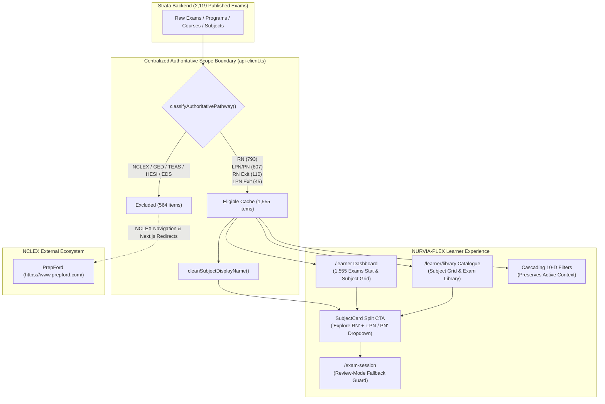

# NURVIA-PLEX — Unified Learner Dashboard, RN/PN Subject Catalogue, Complete Exam Library, Context-Aware Filtering & NCLEX Separation

## 1. Executive Summary

This implementation delivers the functional upgrade for **NURVIA-PLEX**, establishing an authoritative **4-pathway academic boundary**, integrating unified RN/PN subject browsing with intuitive multi-pathway selection, guaranteeing data and count parity between the `/learner` dashboard and `/learner/library` catalogue, eliminating NCLEX and non-nursing content in favor of external PrepFord redirection, preventing Review-mode fallback, and aligning terminology to "Exams".

---

## 2. Authoritative Pathway Classification & Catalogue Audit

### Source Data vs. Eligible Boundary Breakdown

A live retrieval of the entire Strata backend catalogue (`dynamicPerPage=250`) retrieved all **2,119 published examinations** across 9 pages. Per the mandatory scope amendment, NURVIA-PLEX strictly operates on the **4 approved pathways**:

| Scope / Category | Authoritative Identifiers | Exam Count | Scope Status |
| :--- | :--- | :--- | :--- |
| **RN** | Program ID `9` ("RN Nursing Exams"), Assessment ID `10` | **793** | **ELIGIBLE & INCLUDED** |
| **LPN/PN** | Program ID `6` ("LPN Nursing Exams"), Assessment ID `9` | **607** | **ELIGIBLE & INCLUDED** |
| **RN Exit** | Assessment ID `5` ("RN Comprehensive Exit Exam") | **110** | **ELIGIBLE & INCLUDED** |
| **LPN Exit** | Assessment ID `8` ("PN Comprehensive Exit Exam") | **45** | **ELIGIBLE & INCLUDED** |
| **Subtotal NURVIA-PLEX Eligible** | **Strict 4-Pathway Scope** | **1,555** | **DISPLAYED IN NURVIA-PLEX** |
| NCLEX-PN | Assessment ID `6` / Program ID `7` ("NCLEX-PN") | 388 | **EXCLUDED** (Redirected to PrepFord) |
| NCLEX-RN | Assessment ID `7` / Program ID `8` ("NCLEX-RN") | 74 | **EXCLUDED** (Redirected to PrepFord) |
| GED Preparation | Assessment ID `3` / Program ID `5` ("GED") | 78 | **EXCLUDED** (Out of nursing scope) |
| ATI TEAS | Assessment ID `2` / Program ID `2` | 8 | **EXCLUDED** (Pre-admission) |
| HESI A2 | Assessment ID `4` / Program ID `3` | 4 | **EXCLUDED** (Pre-admission) |
| Non-Nursing / EDS | Program ID `13` ("Executive Digital Skills") | 12 | **EXCLUDED** (Corporate) |
| **Subtotal Excluded** | **Platform Out-of-Scope Content** | **564** | **ELIMINATED FROM NURVIA-PLEX** |
| **Total Strata Source Records** | All published records | **2,119** | **FULL PLATFORM INVENTORY** |

> [!IMPORTANT]
> The platform total of 2,119 examinations contains 564 examinations belonging to NCLEX, pre-admission tests (TEAS, HESI A2), GED, and EDS. Displaying the raw 2,119 count would breach the 4-pathway rule. NURVIA-PLEX reports and displays exactly **1,555** verified nursing examinations across both `/learner` and `/learner/library`.

---

## 3. Architecture & Functional Implementation

### 3.1 Centralized Pathway Classification (`src/lib/api-client.ts`)
- **`classifyAuthoritativePathway(item)`**: Centralized gatekeeper enforcing authoritative pathway mapping:
  - `AssessmentId === 5` -> `RN_Exit`
  - `AssessmentId === 8` -> `PN_Exit`
  - `ProgramId === 9` or `AssessmentId === 10` -> `RN`
  - `ProgramId === 6` or `AssessmentId === 9` -> `PN_LPN`
  - All NCLEX, GED, TEAS, HESI A2, and EDS records are strictly rejected (`null`).
- **`cleanSubjectDisplayName(rawName)`**: Cleanses raw subject names by stripping NCLEX prefixes/suffixes and program annotations (e.g., `"NCLEX-RN Pharmacology"` -> `"Pharmacology"`, `"Fundamentals of Nursing - PN"` -> `"Fundamentals of Nursing"`).
- **`fetchAllStrataExams()`**: Paginates and retrieves all 9 pages from Strata with in-memory deduplication and caching.
- **`getStudyLibrarySubjects()`**: Aggregates subjects solely from eligible exams, populating `availablePathways`, `rnExamCount`, and `pnExamCount` per subject.
- **`getStudyLibraryFilters()`**: Restricts filter dimensions (Programs, Courses, Subjects, Pathways) strictly to eligible entities.
- **`getStudyLibrarySummary()`**: Delivers authoritative counts (`totalPublishedStudySets: 1555`).

### 3.2 SubjectCard RN/PN Split CTA (`src/components/study/SubjectCard.tsx`)
- Where a subject exists across multiple pathways (e.g. Pharmacology exists in both RN and LPN/PN), the card renders:
  1. A primary action button (`Explore RN (X)`).
  2. An accessible dropdown trigger chevron button (`aria-haspopup="menu"`).
  3. A popup dropdown menu allowing the learner to choose between **"RN Pathway (X exams)"** and **"LPN / PN Pathway (Y exams)"**.
- For single-pathway subjects, it renders a clean single action button (`Explore RN` or `Explore LPN/PN`).
- Props updated to `onSelectSubject: (subjectName: string, pathway?: string) => void`.

### 3.3 Context-Aware Academic Filtering (`src/components/study/study-library-view.tsx`)
- Downstream filters (Difficulty, Season, School, Exam, Question Type, Topic) preserve the active Pathway and browsing context without destructive resets.
- Deep links and tab switches preserve pathway integrity.

### 3.4 `/learner` Dashboard Parity (`src/app/learner/page.tsx`)
- Displays an **Academic Subject Catalogue** section mirroring `/learner/library` subject browsing, complete with the multi-pathway dropdown CTA.
- Stat counter accurately displays **1,555** available exams.
- NCLEX card points externally to `https://www.prepford.com/` (`target="_blank" rel="noopener noreferrer"`).

### 3.5 Complete NCLEX Separation & Redirection
- **Next.js Redirects** in `next.config.ts`: `/nclex` and `/nclex/:path*` redirect with HTTP 307 to `https://www.prepford.com/`.
- Client-side fallback pages `src/app/nclex/page.tsx` and `src/app/nclex/study/page.tsx` redirect window location immediately to PrepFord with an external link button fallback.
- Shell navigation in `src/components/layout/learner-shell.tsx` renders NCLEX Prep as an external link with `ExternalLink` icon and security attributes.

### 3.6 Terminology Alignment ("Study Sets" -> "Exams")
- Updated all learner-facing labels across search placeholders, header counters, action tooltips, modals, empty states, and page titles from "Study Sets" to "Exams".

### 3.7 Review Mode Fallback Prevention (`src/app/exam-session/page.tsx`)
- Eliminated silent fallback from `mode=Review` to `getActiveAttempt()` when an attempt is unsubmitted or ungraded.
- If `getAttemptReview()` fails or is not ready, sets an explicit error state:
  > *"Review mode is not available for this attempt until it has been submitted and graded."*
- Halts execution safely, preserving the 5-stage `ExamLoadingScreen` loading experience without corrupting learner attempts.

---

## 4. Verification & Test Execution Results

All test suites and linters pass cleanly:

1. **`tests/learner-unified-catalog-and-modes.test.mjs`**: **7/7 PASSED**
   - Authoritative 4-Pathway Classification & Scope Enforcement
   - Subject Display Name Cleansing
   - Review Mode Fallback Prevention
   - PrepFord NCLEX External Redirection
   - SubjectCard Unified RN/PN CTA Selection
   - StudyLibraryCategoryTabs 4-Pathway Alignment
   - `/learner` Subject Catalogue & Stats Parity
2. **`tests/phase-3-10-learner-filters-and-menu.test.mjs`**: **5/5 PASSED**
3. **`tests/exam-identity-and-modes-remediation.test.mjs`**: **7/7 PASSED**
4. **`tests/tutor-mode-integrity.test.mjs`**: **13/13 PASSED**
5. **ESLint (`npm run lint`)**: **PASSED (Exit code 0, zero errors)**
